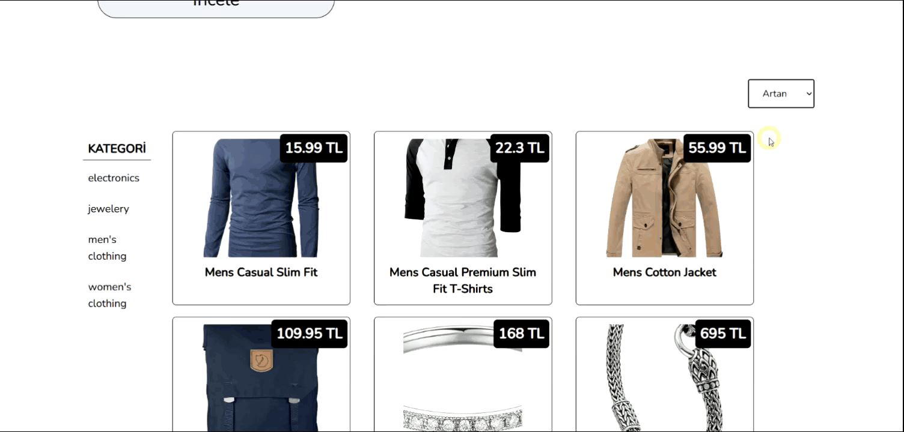

<h1 align="center">🛍️ ShopZon - E-Commerce Project</h1>

ShopZon, React kullanılarak geliştirilmiş modern bir e-ticaret uygulamasıdır. FakeStore API kullanılarak ürünler listelenir, kategorilere göre filtrelenir ve ürün detayları görüntülenebilir.

<h3>✨ Özellikler</h3>

<ul>
  <li>🛒 Ürünleri listeleme</li>
  <li>📂 Kategorilere göre ürün filtreleme</li>
  <li>🔍 Ürün detaylarını görüntüleme</li>
  <li>🛍️ Sepete ürün ekleme ve silme</li>
  <li>🔢 Ürün miktarını belirleme</li>
  <li>💰 Sepet toplam tutarını hesaplama</li>
  <li>💾 LocalStorage ile sepet verilerini saklama</li>
  <li>🎠 Otomatik kayan ürün slider'ı</li>
</ul>

<h3>💻 Kullanılan Teknolojiler</h3>

<ul>
  <li>HTML5</li>
  <li>CSS3</li>
  <li>JavaScript</li>
  <li>React</li>
  <li>Redux Toolkit</li>
  <li>React Router DOM</li>
  <li>Tailwind CSS</li>
  <li>React Slick</li>
  <li>FakeStore API</li>
</ul>

